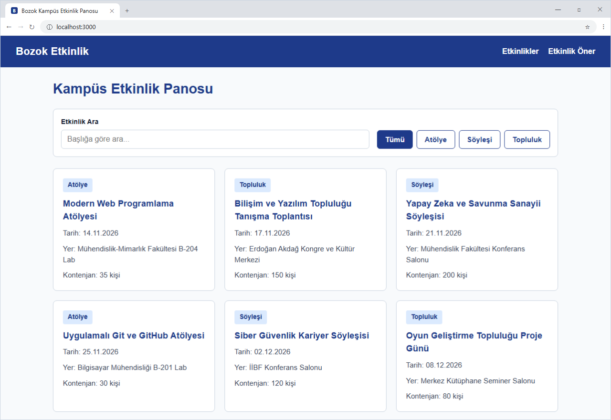

# Kampüs Etkinlik Panosu (BMH231 Ödev 2)

Bu proje, Yozgat Bozok Üniversitesi Bilgisayar Mühendisliği Bölümü **BMH231 Web Programlama** dersi kapsamında geliştirilmiş bir web uygulamasıdır. Kampüsteki atölye, söyleşi ve öğrenci topluluğu etkinliklerini listeler, türe ve başlığa göre filtreleme yapmayı sağlar ve yeni etkinlik önerisi göndermek için istemci taraflı doğrulama içeren bir form sunar. Arka uçta herhangi bir harici kütüphane kullanılmadan yalnızca Node.js yerleşik `http`, `fs` ve `path` modülleriyle geliştirilmiş bir JSON API çalışmaktadır.

## Kurulum ve Çalıştırma Adımları

Projeyi bilgisayarınıza indirip çalıştırmak için aşağıdaki komutları sırasıyla uygulayabilirsiniz:

```bash
git clone https://github.com/eferyy/bmh231-odev2.git
cd bmh231-odev2
npm start
```

Sunucu başlatıldıktan sonra tarayıcınızdan `http://localhost:3000` adresini açarak uygulamayı görüntüleyebilirsiniz.

## API Uç Noktaları

| Yöntem | Yol | Durum Kodu | Açıklama |
| :--- | :--- | :--- | :--- |
| `GET` | `/` ve `/public/*` | `200 OK` | Statik dosyaları (`index.html`, `stil.css`, `betik.js`) uygun `Content-Type` ile döner. |
| `GET` | `/api/etkinlikler` | `200 OK` | `etkinlikler.json` içindeki tüm etkinlikleri JSON dizisi olarak döner. |
| `GET` | `/api/etkinlikler?tur=atolye` | `200 OK` | Sorgu parametresinde belirtilen türe (`atolye`, `soylesi`, `topluluk`) ait etkinlikleri filtreleyerek döner. |
| `GET` | `/api/etkinlikler/:id` | `200 OK` | Belirtilen `id` değerine sahip tek etkinliği JSON nesnesi olarak döner. |
| `GET` | `/api/etkinlikler/999` | `404 Not Found` | Eşleşen etkinlik bulunamadığında `{"hata": "Etkinlik bulunamadı"}` JSON yanıtı döner. |
| `GET` | Bulunmayan diğer yollar | `404 Not Found` | Düz metin (`text/plain`) olarak 404 hata iletisi döner. |
| Diğer (`POST`, `DELETE` vb.) | Tüm yollar | `405 Method Not Allowed` | `Allow: GET` başlığı ile birlikte düz metin hata yanıtı döner. |

## Uygulama Ekran Görüntüsü


